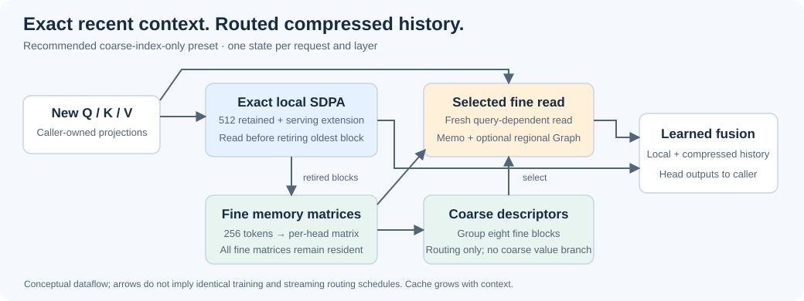

# TaoMemory

**Causal compressed-memory attention with an explicit streaming state.**

TaoMemory combines exact attention over recent tokens with routed, matrix-valued memory of older tokens. It provides a standalone PyTorch/Triton operator: you supply projections, positional transforms and trainable fusion tensors; TaoMemory computes attention and manages each request's history.

This is an experimental implementation, not a drop-in numerical replacement for softmax attention. It has no dependency on a particular language-model backbone. This repository contains the operator, examples, documentation and curated benchmark tables—not training datasets, model checkpoints or internal experiment records.

## What it offers

- **Differentiable training and incremental inference.** Separate full-sequence, prefill and one-new-token decode entry points.
- **Explicit request state.** Per-layer caches with reset and snapshot/export/import; no global conversation cache.
- **Hierarchical history.** Fine memories retain compressed values; coarse summaries route queries to fine memories without contributing a separate coarse value output in the recommended preset.
- **One inference implementation.** Page-normalization memoization and optional regional CUDA Graph execution compose through a configuration flag.
- **Caller-owned model design.** Q/K/V projections, positional encoding, output projection, loss and optimizer remain outside the operator.

## Install

The package requires Python 3.11 or newer. Historical benchmark measurements used **Linux, NVIDIA RTX 4090, Python 3.12, PyTorch 2.9.1+cu128 and Triton 3.5.1**; this does not establish identical behavior or speed for every admitted version. Install a compatible CUDA PyTorch build first, then from this repository:

```bash
python -m pip install --no-deps .
```

The Python package is `tao_attention`. A Python wheel does not imply CPU or Windows execution support. See [installation and usage](docs/usage.md) for the tensor contract and supported scope.

## API at a glance

```python
from tao_attention import new_state, tao_attention, tao_attention_decode
from tao_attention.presets import index_only_page_memo

config = index_only_page_memo(graph=False)

# Training: differentiable full-sequence attention.
# q, k, v, raw_q, raw_k: [batch, tokens, heads, head_dim].
heads = tao_attention(
    q, k, v, raw_q=raw_q, raw_k=raw_k,
    fusion_a=fusion_a, fusion_b=fusion_b,
    alpha=alpha, config=config,
)

# Inference: one state per request AND layer. Supply only the new token.
state = new_state(layer_index=0, config=config)
heads, state = tao_attention_decode(
    q_one, k_one, v_one, raw_q=raw_q_one, raw_k=raw_k_one,
    fusion_a=fusion_a, fusion_b=fusion_b,
    alpha=alpha, state=state, position=state.get_pos(),
)
```

The snippet illustrates the interface; the caller must construct compatible tensors and use inference mode for cached execution. `raw_q/raw_k` precede the caller's Q/K transforms. `fusion_a/fusion_b` have shape `[heads, head_dim, 3]`. Outputs retain the input head layout and precede your output projection. [Runnable examples](examples/) show complete tensor setup.

Use `tao_attention_prefill` for new prompt spans, then `tao_attention_decode` for one new token at a time. Do not send the old prefix again. To enable the integrated history graph, select `index_only_page_memo(graph=True)` and release execution buffers when the request ends. See [streaming and Graph usage](docs/graph.md).

## How memory works



Recent tokens remain exact. Once a block leaves the local window, its tokens contribute to a per-head fine memory matrix. Coarse summaries organize groups of fine memories for routing. A current query selects historical memories, reads their compressed content, and fuses it with its exact local-attention output.

The recommended preset uses a 512-token retained local window plus a serving extension, 256-token fine blocks, groups of eight fine blocks, independent values per head, and a `ceil(sqrt(2 * count)) + 2` routing budget capped by available candidates. Pending exact tokens remain local. All fine matrices are retained, so cache use still grows with sequence length; this is **not constant-memory attention**.

See [architecture and configuration](docs/architecture.md) for the actual tensor roles, configuration surface and inference-state semantics.

## Evidence of potential

These are separate measurements with different contracts. Do not combine their speedups or compare BPBs across tables.

| Matched 8K training, 250 updates | Validation BPB ↓ | Training targets/s ↑ | Training peak allocated GiB ↓ |
|---|---:|---:|---:|
| Native full attention | 1.107371 | 86,103 | 6.12 |
| TaoMemory, all 12 layers | **1.100056** | 34,878 | 7.66 |
| 3 Tao layers : 1 full-attention layer | 1.104262 | 41,498 | 7.24 |

At this single-seed, short training horizon, TaoMemory has lower BPB but is substantially slower to train and uses more training memory. The full-attention model uses native model/cache code with an adapted matched training harness, not an untouched upstream end-to-end run. This is a quality/cost tradeoff, **not overall superiority**.

Memory values are cumulative allocator peaks observed at training update events, including the preceding initial validation; they are not isolated forward/backward-only peaks.

| Same Tao model, advancing decode | Page memo | Page memo + regional CUDA Graph | Change |
|---|---:|---:|---:|
| 16K prompt | 113.330 tok/s | 123.129 tok/s | +8.65% |
| 128K prompt | 107.192 tok/s | 123.816 tok/s | +15.51% |

The latter comparison includes graph capture, copies, refresh/seal work and teardown. It is not a comparison against exact KV. Tested semantic cache sizes were unchanged by the Graph option; process memory includes additional execution state.

The [benchmark report](docs/benchmarks.md) provides complete conditions, common-target 2K–128K quality, retained-cache measurements and limitations. Its tables are organized by architecture and measurement contract, not by experiment chronology.

## Current limits

- Measured streaming coverage is batch size 1 with BF16, head dimensions 64/128; regional Graph evidence is limited to head dimension 128 at 16K/128K. Padding, ragged batches, GQA, other devices and production serving are not established.
- Training and streaming use different routing refresh schedules; bitwise equality across those paths or arbitrary chunk partitions is not promised.
- Stable long-context BPB does not establish successful distant retrieval. Compressed-memory variants have shown substantial key/value-binding deficits relative to exact KV.
- There is no role-aware pinned system-prompt policy. Do not assume old instructions are preserved exactly or always routed into the current read.
- This release does not claim SOTA, pretrained-checkpoint interchangeability, or universal speedups. Historical benchmark results are not a fresh validation of every installation or configuration.

## Develop and contribute

Read [CONTRIBUTING.md](CONTRIBUTING.md), [the API documentation](docs/usage.md), and [the benchmark methodology](docs/benchmarks.md). Contributions that improve real advancing-token performance, causal correctness, request isolation and retrieval quality are particularly useful. Include the exact runtime and distinguish model quality, retained cache, allocator memory and throughput.

Licensed under [MIT](LICENSE). See [NOTICE](NOTICE) for source attribution.
